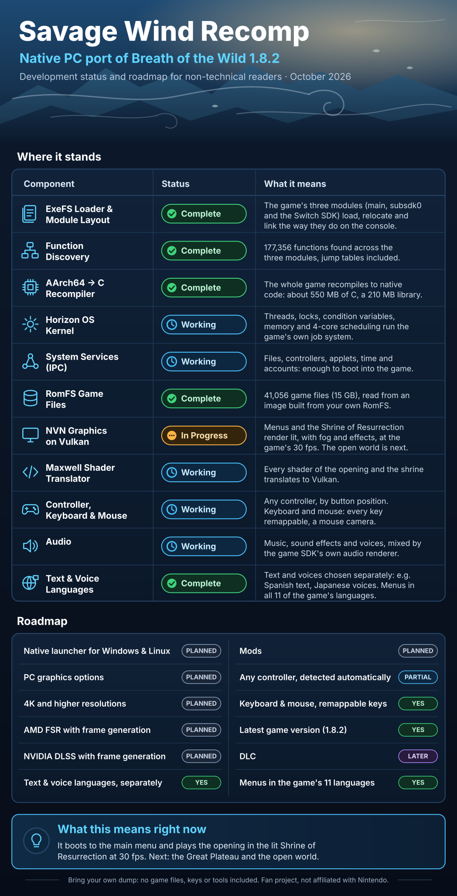

# Savage Wind Recomp

> [!IMPORTANT]
> **This project is made almost entirely with AI.** Nearly all of the code, tooling, reverse engineering and
> documentation here is written by an AI (Anthropic's Claude, through Claude Code), directed, tested and reviewed by
> a human. It builds on [LAS Recomp](https://github.com/peiikai/LASRecomp), which was made the same way. If you don't
> trust code written by AI, you can simply ignore this project. As with anything on the internet, you run the code at
> your own discretion.

**Savage Wind Recomp** is a work-in-progress static recompilation of *The Legend of Zelda: Breath of the Wild*
(Nintendo Switch, version 1.8.2) into a native application for Windows and Linux. The goal is a full PC version of
your own copy of the game: a launcher, PC-style graphics options, mods, any controller, keyboard and mouse, and
its text and voices in any of its languages.

> [!WARNING]
> **Not playable yet.** This is early development. Today the game boots to its main menu and plays the opening in
> the Shrine of Resurrection - lit, with its fog and effects, at the game's own 30 fps, with sound, voices and the
> HUD - and saves. Nothing past the shrine has been tested yet. **Alpha 1** (Windows) is a preview for testers, not
> a way to play the game through.

> [!NOTE]
> **No game files are included.** Savage Wind Recomp needs your own legally obtained copy of the game, updated to
> **version 1.8.2**, dumped from **your own** Nintendo Switch. This project does not include, and will not provide,
> game files, keys, firmware, dumping or decryption tools, or instructions on how to obtain any of them. Savage Wind
> never decrypts anything: it only reads files you have already extracted yourself. The recompilation of the game
> code happens locally, on your machine, from your files.



## What it does today

- **Text and voices in different languages.** On the console the voices always follow the system language. Here
  the menu's Language tab picks the text language (any of the game's 15, or your system's) and, separately, the
  voice language (English, Latin American or European Spanish, French, German, Italian, Russian or Japanese): read
  Spanish with Japanese voices, or English with Italian ones. The game reads both when it starts; in game, Restart
  now applies a change.
- **Menus in the game's 11 languages.** The start screen and the overlay menu follow the text language at once
  (Russian, Japanese, Korean and Chinese use a system font for their characters).
- **Keyboard and mouse.** Defaults made for BOTW (below), every key and mouse button remappable, a mouse camera
  with sensitivity and Y inversion.
- **Any controller** SDL knows, by button position, with its own button names (Nintendo, Xbox, PlayStation).
- **Sound and voices** mixed by the game SDK's own audio renderer, with the room reverb.
- **An overlay menu** (Esc or F1) with display, rendering, audio, language and control settings, and a
  **performance overlay** (F10: FPS and frame times, or also CPU, memory and GPU load and temperatures).

## Respect copyright

- *The Legend of Zelda: Breath of the Wild* is © Nintendo. This is a fan project. It is not affiliated with,
  endorsed by or sponsored by Nintendo. *Nintendo Switch* and *The Legend of Zelda* are trademarks of Nintendo.
- This repository contains no game files, no game code (also not the C code the recompiler generates from it), no
  assets, no fonts, no keys - and release builds won't either.
- The game code you generate and the build made from it contain Nintendo's code. They are for your own use only:
  don't share them, upload them or ship them.
- Issues, pull requests or discussions that contain game files, keys, generated code or links to pirated copies
  will be removed. Piracy is not supported in any way.
- Follow the copyright laws of your country. Dumping a game you own for personal use is legal in some countries and
  not in others; that is your responsibility.

## Getting started (Alpha 1, Windows)

1. Download `SavageWind-0.1.0-alpha.1-windows.zip` from [Releases](https://github.com/Revivedx/SavageWindRecomp/releases)
   and extract it to a folder you can write to (not Program Files): your game files, saves and settings are kept in
   that folder.
2. Run `savagewind.exe`. On the start screen choose **Set up game files**, pick the folder with your own extracted
   game (`exefs/` and `romfs/`, version 1.8.2, see below) and start the setup. It checks the version, copies the
   files, builds the data image and recompiles the game code on your machine - once, and it takes a while (about 40
   minutes with a 12-thread CPU). Your own files aren't changed.
3. **Play**. The overlay menu (Esc or F1) has the settings, including the text and voice languages.

Needs Windows 10 or later, a CPU with AVX2, a GPU with Vulkan 1.3 and about 35 GB of free disk space.

## What you need

- Your own *Breath of the Wild* (cartridge or digital) and its **1.8.2 update**, extracted from your own console:
  - the **ExeFS** of 1.8.2 (`main`, `main.npdm`, `rtld`, `sdk`, `subsdk0`)
  - the **RomFS** with the update applied (base game and 1.8.2 merged)
- DLC: not supported yet (planned, see the roadmap).
- Windows 10 or later (x86-64, a CPU with AVX2) or Linux (x86-64), and a GPU with Vulkan 1.3.

The files go in `extracted/` next to the program (git ignores this folder):

```
extracted/
  exefs/   main, main.npdm, rtld, sdk, subsdk0
  romfs/   the complete RomFS (base game + 1.8.2 merged)
```

The `main` module's build id tells the exact version; `python tools/sw_probe.py` (it reads `extracted/exefs`)
prints it and what the recompiler will find there.

## Building from source

### Windows

More detail in [docs/BUILD-windows.md](docs/BUILD-windows.md).

1. One-time setup, in PowerShell from the repository root:
   `powershell -ExecutionPolicy Bypass -File tools\setup_windows.ps1`.
   It installs MSYS2 (UCRT64: clang, make, SDL3, FFmpeg, Vulkan, shaderc) and Python for the tools, and switches
   the clone to LF line endings.
2. From an MSYS2 UCRT64 shell (or Git Bash with `export PATH="/c/msys64/ucrt64/bin:/c/msys64/usr/bin:$PATH"`):
   - `make -j` builds the app, `build/savagewind.exe`.
   - Put your files in `extracted/` (above), then `make gen` (recompiles the game code into `generated/`, about a
     minute) and `make -j` again (builds it into `build/swgame.dll`; the first build takes 15-20 minutes).
   - `build/savagewind.exe extracted --build-romfs` packs your RomFS into the image the runtime reads
     (`extracted/romfs.bin`, about 15 GB).
3. Run: `build/savagewind.exe extracted --play`, from a shell with `C:\msys64\ucrt64\bin` on PATH.

### Linux

See [docs/linux.md](docs/linux.md): the same steps with the distribution's clang, SDL 3, FFmpeg, shaderc and Vulkan
Memory Allocator (`build/savagewind`, `build/swgame.so`).

Developer notes (in Spanish) - what was changed from LAS Recomp, how the boot got this far, and the debugging
switches - are in [docs/SAVAGE-WIND.md](docs/SAVAGE-WIND.md).

## Roadmap

- Correct graphics on the Great Plateau, then the rest of the game
- Always the latest game version (1.8.2 today); DLC support later
- A launcher for Windows and Linux with PC-style graphics options (the start screen: Windows in Alpha 1, Linux next)
- Higher internal resolutions, up to 4K and beyond
- Upscaling with frame generation: AMD FSR and NVIDIA DLSS (each under its SDK's own license)
- Mods
- Automatic recognition of any controller (today: any controller SDL knows, by button position)
- Higher frame rates than the console's 30 fps (needs the game's timing patched)

## Controls

Any controller SDL knows works, by button position. Keyboard and mouse defaults:

| Action | Key | Action | Key |
|---|---|---|---|
| Move | W A S D | Camera | Mouse (or I J K L) |
| Walk (hold) | C | Crouch | Left Ctrl |
| Jump (X) | Space | Sprint / back (B) | Left Shift |
| Interact / confirm (A) | E | Attack (Y) | Left click |
| Shield / lock on (ZL) | Right click | Bow (ZR) | F |
| Rune (L) | Q | Throw (R) | R |
| Look (right stick press) | Middle click | D-pad | Arrow keys |
| Inventory (Plus) | Tab | Map (Minus) | M |

Every key and mouse button can be remapped in the overlay menu (Esc or F1), which also frees the cursor and has the
mouse sensitivity and Y inversion. F10 cycles the performance overlay (off, FPS, full).

## How it works

The game's AArch64 executables are translated to C (`tools/gen.py`) and compiled into a library next to the app. The
runtime replaces the Switch underneath it: a kernel and the system services (IPC), the NVN graphics API on top of
Vulkan with a Maxwell shader translator, and audio. This is not emulation of the console; the game's own code runs
natively. All of this comes from LAS Recomp, generalized for a much bigger game (about 196,000 functions in three
modules).

## Credits

- **[LAS Recomp](https://github.com/peiikai/LASRecomp)** by peiikai - the recompiler, the runtime and most of what
  this project is built on (MIT).
- [Ryujinx](https://github.com/Ryujinx/Ryujinx) (MIT) - its shader decoder was the reference for instruction field
  layouts.
- [envytools](https://github.com/envytools/envytools) - NVIDIA GPU documentation used for the shader translator.
- The Switch homebrew community's documentation ([Switchbrew](https://switchbrew.org)).
- [Ghidra](https://github.com/NationalSecurityAgency/ghidra) and the
  [Switch Loader](https://github.com/Adubbz/Ghidra-Switch-Loader) - used for reverse engineering (not bundled).
- Libraries: [SDL 3](https://libsdl.org) (zlib), [FFmpeg](https://ffmpeg.org) (LGPL),
  [Dear ImGui](https://github.com/ocornut/imgui) (MIT),
  [Vulkan Memory Allocator](https://github.com/GPUOpen-LibrariesAndSDKs/VulkanMemoryAllocator) (MIT),
  [SMAA](https://github.com/iryoku/smaa) (MIT), [AMD FidelityFX Super Resolution 1](https://github.com/GPUOpen-Effects/FidelityFX-FSR)
  (MIT), [Baloo 2](https://github.com/EkType/Baloo2) (SIL OFL 1.1), [shaderc](https://github.com/google/shaderc)
  (Apache 2.0), [Zig](https://ziglang.org) (MIT), [Capstone](https://www.capstone-engine.org) (BSD),
  [Unicorn](https://www.unicorn-engine.org) (GPL 2.0), [python-lz4](https://github.com/python-lz4/python-lz4) (BSD).

## License

Savage Wind Recomp's own code is open source under the [MIT License](LICENSE), as is LAS Recomp's, on which it
builds. Third-party components in `third_party/` keep their own licenses. The license covers this project's code
only: it grants nothing for Nintendo's game, which you must supply yourself.

The Windows release zip also bundles, unchanged unless noted, under their own licenses:

- FFmpeg 9.0.2 (libavcodec, libavformat, libavutil, libswscale), LGPL 2.1 or later: built from the official
  [source](https://ffmpeg.org/releases/ffmpeg-9.0.2.tar.xz) as LGPL only, without GPL or nonfree parts, by
  [tools/build_deps_windows.sh](tools/build_deps_windows.sh). They are separate DLLs: you can replace them with your
  own build of the same version.
- From [MSYS2](https://packages.msys2.org) (UCRT64, sources there): SDL 3.4.18 (zlib), shaderc 2026.4 (Apache 2.0),
  libiconv 1.19 (LGPL 2.1 or later), the GCC 16.2 runtime (libgcc, libstdc++: GPL 3 with the GCC Runtime Library
  Exception) and winpthreads (MIT and BSD).
- Zig 0.17.0 (MIT; its bundled LLVM, Clang and LLD: Apache 2.0 with LLVM Exceptions; the MinGW-w64 headers and
  runtime: their own permissive licenses), trimmed to what the game code build uses.
- `swgen/`, this project's generator frozen with PyInstaller 6.22 (GPL 2.0 with the bootloader exception): Python
  3.14 (PSF License), Capstone 5.0.9 (BSD), [Unicorn 2.1.4](https://github.com/unicorn-engine/unicorn/tree/2.1.4)
  (GPL 2.0, source at that link) and python-lz4 4.4.5 (BSD).
- The Baloo 2 font (SIL OFL 1.1, `Baloo2-OFL.txt`).

---

## Español (resumen)

**Savage Wind Recomp** es una recompilación estática, en desarrollo, de *The Legend of Zelda: Breath of the Wild*
(Switch, versión 1.8.2) para Windows y Linux. **Todavía no se puede jugar**: hoy llega al menú principal y corre la
introducción en el Santuario de la Vida, iluminado, a los 30 FPS del juego, con sonido y voces.

- **Texto y voces en idiomas distintos**: en la consola las voces siguen siempre al idioma del sistema; aquí eliges
  el idioma del texto (cualquiera de los 15 del juego) y, por separado, el de las voces (por ejemplo, texto en
  español con voces en japonés). Los menús de Savage Wind están en los 11 idiomas del juego.
- Teclado y ratón con todas las teclas reasignables, cualquier mando, y un indicador de rendimiento (F10).
- **Alpha 1** (Windows), una versión de prueba: descarga el zip desde
  [Releases](https://github.com/Revivedx/SavageWindRecomp/releases), extráelo en una carpeta donde puedas escribir,
  abre `savagewind.exe`, elige **Set up game files** con tu juego extraído (1.8.2) y después **Play**. La preparación
  se hace una sola vez y tarda unos 40 minutos; necesita unos 35 GB libres.

- No incluye archivos del juego, código del juego, assets, fuentes ni keys, y nunca los va a incluir.
- Necesitas tu propia copia legal del juego actualizada a la **1.8.2**, extraída de **tu propia** consola. Este
  proyecto no da ni va a dar herramientas, keys ni instrucciones para obtener esos archivos, y no desencripta nada.
- El código que se genera a partir de tu copia es solo para tu uso: no lo compartas.
- Respeta las leyes de derechos de autor de tu país. No es un proyecto de Nintendo ni está respaldado por Nintendo.
